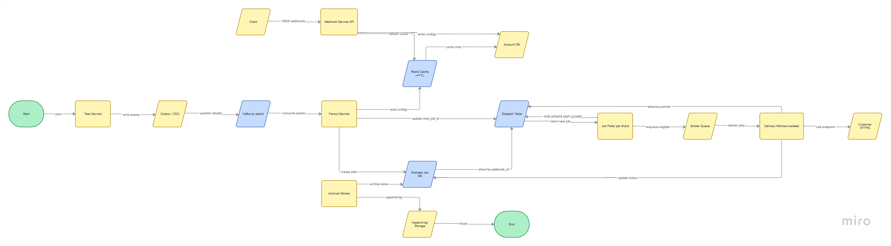

# Webhook Service Design

This document summarizes the design for a webhook notification system built for task events.

For more detailed requirements and constraints, see [notes.txt](./notes.txt).

## 1. Goal

Allow customers to register HTTPS endpoints and receive event notifications for task lifecycle changes such as creation, updates, and deletion. The design supports:

- webhook CRUD and lifecycle management
- event-driven fanout
- delivery retries and replay
- safer handling of slow or failing endpoints
- scale-out for growing traffic and workloads

## 2. Functional Requirements

- Register, update, and remove webhook endpoints for an account.
- Enable or disable an endpoint without deleting the configuration.
- Subscribe to selected event types:
  - `task.created`
  - `task.updated` (optionally filtered to `startDate` changes)
  - `task.deleted`
- Deliver matching events to the account's HTTPS endpoint.
- Retry transient failures and expose permanently failing deliveries for investigation and replay.
- Let customers verify endpoint ownership and send a test event.
- Show delivery health and history so customers can tell whether a webhook is configured correctly and continues to work.
- Preserve event ordering per resource; `task.updated` without a prior `task.created` is not useful.

## 3. Non-Functional Requirements

- Task writes must not block on customer HTTP responses.
- Events must not be lost after the corresponding task change is committed.
- Slow or failing customer endpoints must be isolated from each other.
- Use bounded timeouts, retry limits, and queue depth controls.
- Support horizontal scaling of publishers and delivery workers.
- Protect endpoint secrets and authenticate webhook payloads.
- Expose backlog, failures, retries, and recovery metrics.

## 4. Scale

Initial design target:

- 100 accounts
- 2,000 projects
- 200,000 tasks
- ~100k events/hour (~28 events/second)

Planned 10x growth model:

- 1,000 accounts
- 20,000 projects
- 2M tasks
- ~1M events/hour (~350 events/second)

## 5. Key Design Principles

- Do not trust account identity from the request body; derive it from the authenticated caller.
- Use transactional outbox / CDC from event-producing services to guarantee at-least-once event emission.
- Keep the webhook CRUD surface near the account system, but isolate webhook job processing from the live task write path.
- Use independent tables and workers for triggering delivery so task services can stay decoupled from customer HTTP latency.
- Keep event ordering per resource (task ID) while allowing fanout to scale horizontally.

## 6. Proposed Architecture



### Components

1. Webhook Service
   - Manages webhook configuration for each account.
   - Exposes CRUD APIs for webhooks and delivery inspection.
   - Maintains webhook registration, endpoint state, secret metadata, and subscription filters.
   - Reads are high-volume, but the design avoids creating a separate database if the existing account database is adequate.

2. Event-producing Services
   - Example: task service.
   - Produces domain events such as `task.created`, `task.updated`, and `task.deleted`.
   - Uses transactional outbox or CDC to emit events reliably.
   - Does not wait for webhook HTTP delivery to succeed.

3. Fanout Service
   - Consumes events from Kafka.
   - Partitions by `taskId` to preserve ordering per task resource.
   - Finds the account's configured webhooks and inserts delivery jobs into a dedicated job table.
   - Reads webhook configuration directly from the account database or a cache to minimize latency.

4. Webhook Delivery Workers
   - Poll jobs from the webhook job database.
   - Claim jobs with locking, timeout, and attempt tracking.
   - Send HTTPS requests to each endpoint, respect timeout constraints, and update status.
   - Retry transient failures with exponential backoff and deduplicate by job ID or event ID.

5. Archival Worker
   - Moves completed or old jobs to a read-only or append-only archival store.
   - Prevents the primary delivery table from growing indefinitely.
   - Keeps recent data hot and older history accessible for audit and replay.

6. Data Stores
   - Account DB: holds account and webhook configuration data.
   - Kafka: event stream for reliable propagation.
   - Webhook Job DB: stores dispatch jobs, attempts, retries, and delivery state.
   - Optional Redis: cache for quick webhook lookup for hot endpoints.

## 7. API Surface

```http
POST   /v1/webhooks
GET    /v1/webhooks
GET    /v1/webhooks/{webhookId}
PATCH  /v1/webhooks/{webhookId}
DELETE /v1/webhooks/{webhookId}
POST   /v1/webhooks/{webhookId}/test
GET    /v1/webhooks/{webhookId}/deliveries
POST   /v1/webhooks/{webhookId}/deliveries/{deliveryId}/replay
```

Example registration payload:

```json
{
  "url": "https://hooks.example.com/task-events",
  "enabled": true,
  "subscriptions": [
    { "eventType": "task.created" },
    { "eventType": "task.updated", "changedFields": ["startDate"] }
  ]
}
```

## 8. Event and Job Flow

1. A task service changes task state.
2. The task change is committed with a transactional outbox record.
3. An event is emitted to Kafka.
4. Fanout service consumes the event and resolves matching webhook subscriptions for the account.
5. A job is inserted into the webhook job database for each matching webhook.
6. Delivery workers claim jobs and perform HTTPS calls.
7. If the call succeeds, the job is marked as succeeded.
8. If the call fails transiently, retry with backoff.
9. If it fails permanently, the system records the delivery and exposes it for investigation or replay.

## 9. Delivery Locking Pattern

The system uses DB-based locking to avoid duplicate workers processing the same job at the same time.

```sql
BEGIN;

WITH candidate AS (
    SELECT j.id
    FROM jobs j
    WHERE (
        (
            j.status = 'PENDING'
            AND (j.retry_at IS NULL OR j.retry_at <= NOW())
        )
        OR
        (
            j.status = 'PROCESSING'
            AND (j.locked_until IS NULL OR j.locked_until <= NOW())
        )
    )
    AND NOT EXISTS (
        SELECT 1
        FROM jobs earlier
        WHERE earlier.webhook_id = j.webhook_id
          AND (earlier.created_at, earlier.id) < (j.created_at, j.id)
          AND earlier.status <> 'SUCCEEDED'
    )
    ORDER BY j.created_at ASC, j.id ASC
    LIMIT 1
    FOR UPDATE OF j SKIP LOCKED
)
UPDATE jobs j
SET status = 'PROCESSING',
    locked_until = NOW() + INTERVAL '60 seconds',
    attempts = attempts + 1
FROM candidate c
WHERE j.id = c.id
RETURNING j.*;

COMMIT;
```

This pattern ensures one active delivery attempt per webhook while allowing retry after timeout.

## 10. Bottlenecks and Mitigations

### Bottleneck 1: Expensive read lookups for webhook config in fanout
Mitigation:
- Put hot webhook config in Redis.
- Invalidate or version cache entries when configuration changes.
- Accept that stale data may happen and prefer a bounded refresh strategy.

### Bottleneck 2: High cost in the job-picking query
Mitigation:
- Add a `job_dispatch` table with pointer state for the next job per webhook.
- Update dispatch rows in the same transaction as the job claim.
- Reduce expensive scanning on the job table.

### Bottleneck 3: Job database load under sustained peak traffic
Mitigation:
- Partition or shard the database on webhook ID or hash-based key ranges.
- Replica reads and isolate writes for hot workloads.
- Scale consumer workers horizontally.

## 11. Reliability and Operational Notes

- Event ordering is enforced per task resource to avoid out-of-order updates.
- Customer HTTP calls should be bounded by connection timeout, response timeout, and retry budget.
- Endpoint secrets must be protected and rotated safely.
- Delivery jobs should be observable through metrics, traces, and per-webhook health dashboards.
- Job archival should remove old entries without hurting live delivery throughput.

## 12. Final Summary

The design intentionally separates webhook registration from delivery processing. The task service emits reliable events without blocking on network calls. The fanout service filters and fans those events to the matching webhooks, while dedicated worker processes deliver them with retry and locking semantics. This keeps the task write path fast, isolates customer endpoint failures, and provides a path to scale beyond the initial product size.
